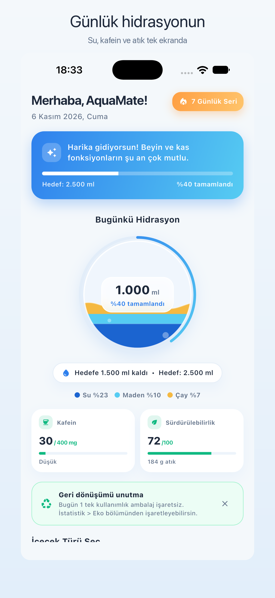
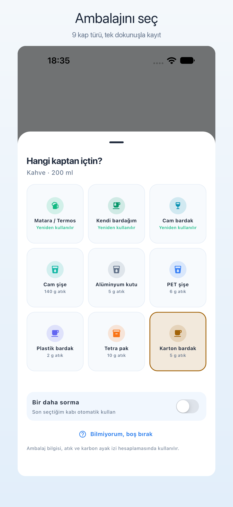
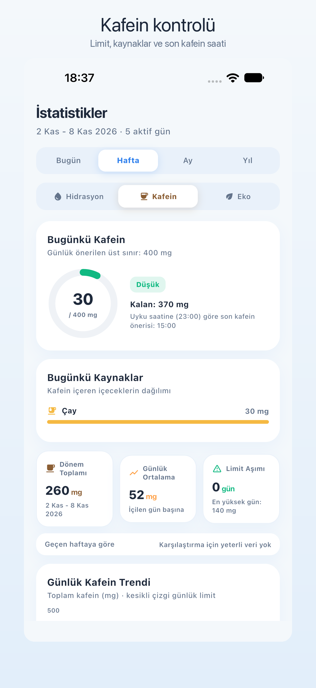
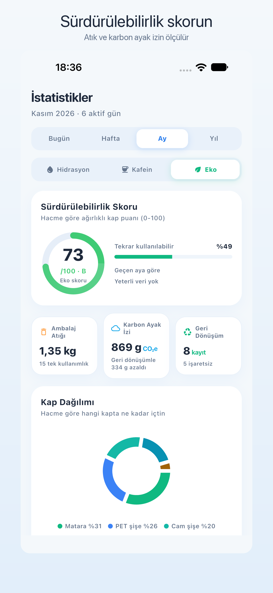
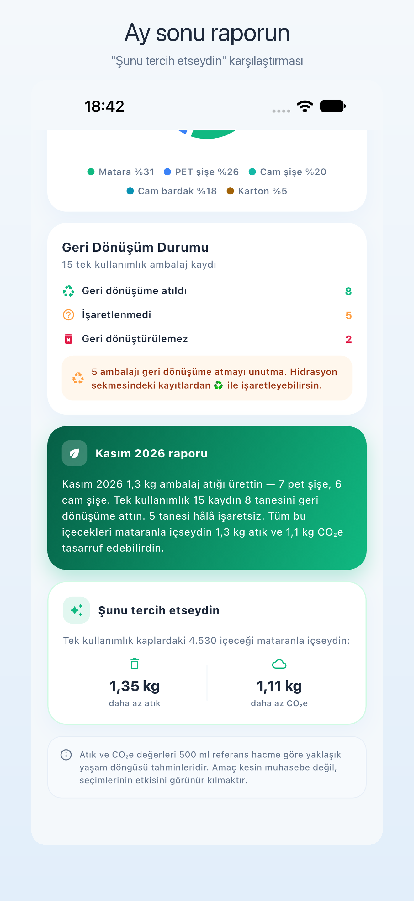
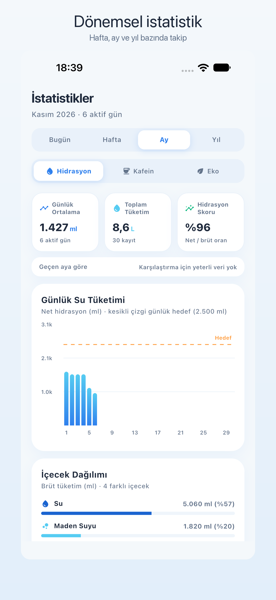

# AquaMate

Hidrasyon, kafein ve ambalaj atığı takibi. Flutter ile yazılmış, tamamen
çevrimdışı çalışan bir mobil uygulama.


## Ne yapar?

| Modül | Açıklama |
|---|---|
| **Hidrasyon** | Her içeceğin biyoyararlanım katsayısıyla net su katkısı, akıllı günlük hedef, seri takibi |
| **Kafein** | Günlük üst sınır, içecek bazlı kafein hesabı, kaynak dağılımı, uyku saatine göre "son kafein saati" |
| **Sürdürülebilirlik** | Her eklemede kap seçimi, atık (g) ve CO₂e hesabı, eko skoru, geri dönüşüm takibi, ay sonu raporu ve "şunu tercih etseydin" karşılaştırması |
| **Dönemsel istatistik** | Bugün / hafta / ay / yıl bazında özetler, önceki döneme göre değişim, hedef tutturma oranı |
| **Katalog** | 22 yerleşik içecek + kullanıcı tanımlı özel içecekler (hidrasyon, kafein, simge, renk) |

## Ekran görüntüleri

| Ana Sayfa | Kap Seçimi | Kafein |
|---|---|---|
|  |  |  |

| Eko skoru | Ay sonu raporu | Dönemsel istatistik |
|---|---|---|
|  |  |  |

## Ekranlar

```
Ana Sayfa   → günlük küre, hedef, kafein ve eko mini kartları, hızlı ekleme
İstatistik  → period seçici + Hidrasyon / Kafein / Eko sekmeleri
Rehber      → video, sesli rehber, kafein ve ambalaj bilgi kartları
Ayarlar     → hedef, kafein limiti, uyku saati, sürdürülebilirlik, bildirimler
```

## Kurulum

```bash
git clone https://github.com/mehmetefeaytas/aquamate.git
cd aquamate
flutter pub get
flutter run
```

Gereksinimler: Flutter 3.44+ (Dart 3.12), Xcode 27 (iOS) veya Android SDK 35+.

## Test ve analiz

```bash
flutter analyze   # sıfır uyarı hedefi
flutter test      # 67 birim + widget testi
```

## TestFlight

Son yükleme: **1.0.0 (build 5)** — IC iç grubunda `IN_BETA_TESTING`.

APK indirme (kalıcı link):
[**AquaMate-1.0.0-build5-arm64-v8a.apk**](https://github.com/mehmetefeaytas/aquamate/releases/download/v1.0.0/AquaMate-1.0.0-build5-arm64-v8a.apk)
— [tüm sürümler](https://github.com/mehmetefeaytas/aquamate/releases/latest)

```bash
./tool/build_release.sh ipa
xcrun altool --upload-app --type ios -f build/ios/ipa/AquaMate.ipa \
  --apiKey <KEY_ID> --apiIssuer <ISSUER_ID>
python3 tool/asc_testflight.py status 5    # işleme durumu
python3 tool/asc_testflight.py setup  5    # test notlarını yaz
```

## Derleme

```bash
./tool/build_release.sh apk   # imzalı release APK (dist/)
./tool/build_release.sh ipa   # TestFlight IPA
./tool/setup_keystore.sh      # ilk seferde Android keystore üretimi
```

Ayrıntılı dağıtım adımları: [`store/testflight-beta-info.md`](store/testflight-beta-info.md)

## Mimari

```
lib/
  core/            app_info.dart            uygulama kimliği, yasal metinler
  models/          drink_catalog.dart       içecek kataloğu + kafein + kayıt defteri
                   container_type.dart      kap kataloğu (atık / CO₂e / eko puanı)
                   eco.dart                 eko hesaplayıcı ve anlatı üretici
                   period.dart              dönem aralıkları
                   models.dart              WaterLog, UserSettings, kafein yardımcıları
  data/            database_helper.dart     SQLite v2 (migrasyon dahil)
  services/        drink_repository.dart    yerleşik + özel içecek birleşimi
                   period_stats_service.dart dönemsel istatistik motoru (saf/test edilebilir)
                   notification_service.dart su, geri dönüşüm ve haftalık eko bildirimleri
                   sound_service.dart        damla ses efekti
  screens/         home / stats (+3 sekme) / guide / settings / onboarding
                   drink_library / drink_editor / about
  widgets/         wave_painter, eco_widgets, period_bar_chart, container_picker_sheet
  theme/           app_theme.dart           renk ve tipografi sistemi
```

## Veri modeli

```sql
water_logs(id, drink_type, raw_amount, effective_amount,
           caffeine_mg, container_type, recycled, created_at)

custom_drinks(id, label UNIQUE, hydration_factor, caffeine_per_100ml,
              icon_index, color_value, category, default_container, created_at)

user_settings(id, weight, activity_minutes, daily_goal, reminder_interval,
              notifications_enabled, caffeine_limit_mg, bedtime_minutes,
              eco_reminder_enabled, ask_container, last_container, onboarding_done)
```

v1 → v2 geçişinde kolonlar `ALTER TABLE` ile eklenir; mevcut kayıtlar korunur ve
ambalajı bilinmeyen eski kayıtlar eko hesabından hariç tutulur.

## Hesaplama referansları

| Değer | Kaynak / varsayım |
|---|---|
| Hidrasyon katsayısı | Su 1.0, çay 0.85, kahve 0.80 (biyoyararlanım literatürü) |
| Kafein (mg/100 ml) | Filtre kahve 40, espresso 212, Türk kahvesi 100, çay 15, kola 10, enerji 32 |
| Günlük kafein limiti | 400 mg (EFSA / FDA, sağlıklı yetişkin) |
| Ambalaj atığı | 500 ml referans, LCA yaklaşık değerleri (PET 14 g, karton bardak 12 g) |
| Geri dönüşüm CO₂e avantajı | ~%40 tasarruf |

Bu değerler tahminidir; uygulama tıbbi tavsiye vermez.

## Gizlilik

Hiçbir veri toplanmaz, hiçbir sunucuya gönderilmez. Tüm kayıtlar cihazdaki
SQLite veritabanında tutulur. Ayrıntılar: [`store/privacy-policy.html`](store/privacy-policy.html)

## Lisans

MIT — ayrıntılar için [LICENSE](LICENSE). Üçüncü taraf paket lisansları uygulama
içindeki **Hakkında → Açık Kaynak Lisansları** ekranından görülebilir.

## Geliştirici

**Mehmet Efe Aytaş** — <https://linktr.ee/efeyapiyor>
İletişim: efeyapiyor@gmail.com

Bu bilgiler uygulama içindeki **Ayarlar → Hakkında** ekranında da yer alır.
